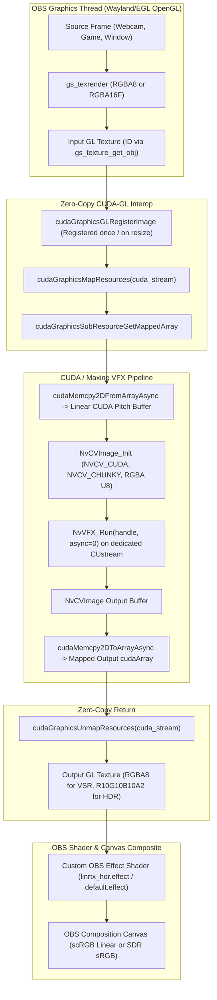
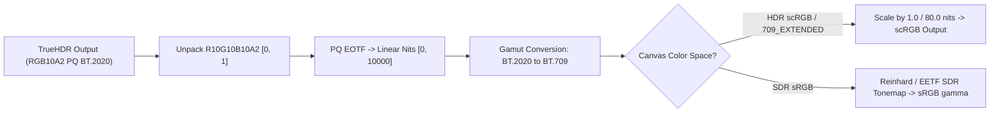

# LinRTX-OBS Architecture & Per-Frame Pipeline

## 1. Overview

`LinRTX-OBS` provides two native Linux video filters for OBS Studio:
1. **RTX Video Super Resolution (VSR)**: Real-time AI upscaling, edge preservation, artifact reduction, and deblurring.
2. **RTX HDR (TrueHDR)**: Real-time SDR-to-HDR10 reconstruction with correct color gamut and scRGB transfer curves.

Both filters execute entirely on the GPU via zero-copy CUDA–OpenGL interop with no CPU readbacks in the rendering loop.

---

## 2. Per-Frame Processing Pipeline

---

## 3. Component Architecture

### 3.1 Module Breakdown
- **`src/plugin-main.cpp`**: Plugin entry point (`obs_module_load`, `obs_module_unload`, locale, frontend checks).
- **`src/nvvfx-loader.h / .cpp`**: Safe dynamic loading of `libVideoFX.so`, `libNVCVImage.so`, and feature libraries. Search path resolution (`LINRTX_SDK_PATH`, venv auto-detect, `/usr/local/VideoFX/lib`, etc.).
- **`src/cuda-gl-interop.h / .cpp`**: Manages CUDA context, stream creation/destruction, and `cudaGraphicsResource_t` registration/mapping for OpenGL textures.
- **`src/filter-vsr.cpp`**: Implementation of `obs_source_info` for RTX Video Super Resolution filter.
- **`src/filter-truehdr.cpp`**: Implementation of `obs_source_info` for RTX TrueHDR filter and HDR color space negotiation.
- **`data/effects/linrtx_hdr.effect`**: Vertex & pixel shader doing PQ ST.2084 decoding, BT.2020 $\to$ BT.709 matrix multiplication, scRGB scaling ($1.0 = 80$ nits), and SDR canvas tonemapping.
- **`data/locale/en-US.ini`**: Localized strings, property tooltips, and status diagnostics.

---

## 4. Color Space Management for TrueHDR

### Mathematical Definitions:
1. **PQ ST.2084 EOTF**:
   $$L = 10000 \times \left(\frac{\max(V^{1 / 78.84375} - 0.8359375, 0)}{18.8515625 - 18.6875 \cdot V^{1 / 78.84375}}\right)^{1 / 0.1593017578}$$
2. **Color Space Matrix (Rec.2020 $\to$ Rec.709)**:
   $$\begin{pmatrix} R_{709} \\ G_{709} \\ B_{709} \end{pmatrix} = \begin{pmatrix} 1.660491 & -0.587641 & -0.072850 \\ -0.124550 & 1.132900 & -0.008349 \\ -0.018151 & -0.100579 & 1.118730 \end{pmatrix} \begin{pmatrix} R_{2020} \\ G_{2020} \\ B_{2020} \end{pmatrix}$$
3. **scRGB Output**:
   $$C_{scRGB} = \frac{C_{709}}{80.0}$$

---

## 5. Thread Safety & Lifecycle

1. **OBS Graphics Thread**:
   - `video_render`, `gs_texrender_*`, and OpenGL draw calls are strictly executed within the OBS graphics context.
2. **CUDA Context & Streams**:
   - CUDA runtime is initialized on device 0 (`cudaSetDevice(0)`).
   - Dedicated `CUstream` created per filter instance via `NvVFX_CudaStreamCreate`.
   - Texture re-registration occurs only when input source dimensions or target scale factors change, avoiding per-frame OpenGL/CUDA allocation overhead.
3. **Error Isolation**:
   - Any CUDA or NVVFX failure immediately flags the filter instance as bypassed.
   - The filter seamlessly falls back to rendering the source unaltered using standard pass-through rendering, ensuring OBS never freezes or crashes.
